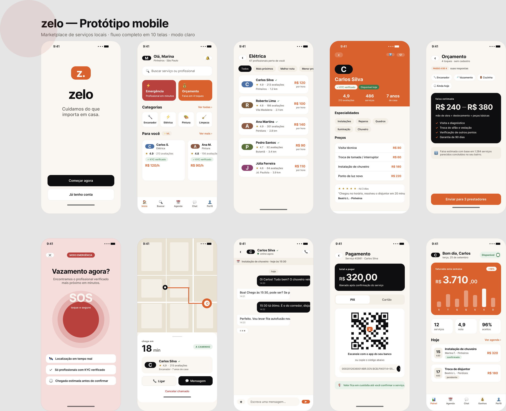

# zelo — Protótipo Figma

Protótipo visual mobile do zelo, exportado como PNG.

**Arquivo Figma:** <https://www.figma.com/design/uhcieIr4qvhtYfCJvmmkgO>

## Telas

| # | Tela | Arquivo |
|---|---|---|
| 01 | Welcome | [`01-welcome.png`](./01-welcome.png) |
| 02 | Home | [`02-home.png`](./02-home.png) |
| 03 | Categoria · Elétrica | [`03-categoria-eletrica.png`](./03-categoria-eletrica.png) |
| 04 | Perfil do prestador | [`04-perfil-prestador.png`](./04-perfil-prestador.png) |
| 05 | Orçamento Inteligente | [`05-orcamento-inteligente.png`](./05-orcamento-inteligente.png) |
| 06 | SOS · Emergência | [`06-sos-emergencia.png`](./06-sos-emergencia.png) |
| 07 | Match encontrado | [`07-match-encontrado.png`](./07-match-encontrado.png) |
| 08 | Chat | [`08-chat.png`](./08-chat.png) |
| 09 | Pagamento PIX | [`09-pagamento-pix.png`](./09-pagamento-pix.png) |
| 10 | Painel do prestador | [`10-painel-prestador.png`](./10-painel-prestador.png) |

## Especificações

- Viewport: iPhone 14 (390 × 844 pt)
- Paleta: [`docs/brand/BRAND-KIT.md`](../docs/brand/BRAND-KIT.md)
- Tipografia: Inter (400/500/600/700)
